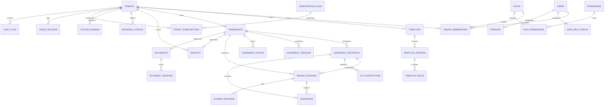

# GSIGN — Relational Database Schema & Multi-Tenant RLS Blueprint

**Product:** GSIGN (Digital Agreement Management & Electronic Signature Platform)  
**Database Engine:** PostgreSQL 16+ (ACID Compliant)  
**Primary Key Standard:** UUIDv7 (Time-ordered, index-friendly UUIDs)  
**Tenant Isolation Standard:** PostgreSQL Row-Level Security (RLS) with Session-Scoped Variables  
**Audit Standard:** Append-Only Immutable Ledger with SHA-256 State Hashing

---

## 1. Entity Relationship Diagram (ERD)



---

## 2. Table Specifications & Detailed DDL

### 2.1 Core Identity, Tenants & Access Control

#### `tenants`
Root customer accounts representing an enterprise, company, SME, or agency.

| Column | Data Type | Constraints | Description |
|---|---|---|---|
| `id` | `UUID` | `PRIMARY KEY DEFAULT gen_random_uuid()` | Unique tenant identifier (UUIDv7). |
| `name` | `VARCHAR(255)` | `NOT NULL` | Registered company / business name. |
| `slug` | `VARCHAR(64)` | `NOT NULL UNIQUE` | URL-safe identifier (e.g., `acme`). |
| `cin` | `VARCHAR(21)` | `NULL` | Corporate Identification Number (India). |
| `gstin` | `VARCHAR(15)` | `NULL` | GST Identification Number (India). |
| `contact_email` | `VARCHAR(255)` | `NOT NULL` | Primary administrator email. |
| `contact_phone` | `VARCHAR(20)` | `NOT NULL` | Primary contact phone number. |
| `status` | `VARCHAR(32)` | `NOT NULL DEFAULT 'Active'` | `Active`, `Trial`, `Suspended`, `Payment failed`. |
| `created_at` | `TIMESTAMPTZ` | `NOT NULL DEFAULT NOW()` | Record creation timestamp. |
| `updated_at` | `TIMESTAMPTZ` | `NOT NULL DEFAULT NOW()` | Record update timestamp. |

#### `users`
Global user identity. A user may hold memberships across multiple tenants.

| Column | Data Type | Constraints | Description |
|---|---|---|---|
| `id` | `UUID` | `PRIMARY KEY DEFAULT gen_random_uuid()` | Unique user identifier. |
| `email` | `VARCHAR(255)` | `NOT NULL UNIQUE` | Normalized lowercase work email. |
| `password_hash` | `TEXT` | `NOT NULL` | Argon2id cryptographic password hash. |
| `full_name` | `VARCHAR(128)` | `NOT NULL` | User full name. |
| `phone_number` | `VARCHAR(20)` | `NULL` | Mobile phone for SMS verification. |
| `is_super_admin` | `BOOLEAN` | `NOT NULL DEFAULT FALSE` | Flag granting root platform operator privileges. |
| `is_active` | `BOOLEAN` | `NOT NULL DEFAULT TRUE` | Active/deactivated flag. |
| `email_verified_at` | `TIMESTAMPTZ` | `NULL` | Timestamp of email verification. |
| `created_at` | `TIMESTAMPTZ` | `NOT NULL DEFAULT NOW()` | Record creation timestamp. |
| `updated_at` | `TIMESTAMPTZ` | `NOT NULL DEFAULT NOW()` | Record update timestamp. |

#### `tenant_memberships`
Binds a user to a tenant with an assigned role and department.

| Column | Data Type | Constraints | Description |
|---|---|---|---|
| `id` | `UUID` | `PRIMARY KEY DEFAULT gen_random_uuid()` | Unique membership ID. |
| `tenant_id` | `UUID` | `NOT NULL REFERENCES tenants(id) ON DELETE CASCADE` | Tenant ownership. |
| `user_id` | `UUID` | `NOT NULL REFERENCES users(id) ON DELETE CASCADE` | User identifier. |
| `role_id` | `UUID` | `NOT NULL REFERENCES roles(id)` | Role reference. |
| `department` | `VARCHAR(64)` | `NOT NULL DEFAULT 'Executive'` | `HR`, `Legal`, `Ops`, `Sales`, `Executive`. |
| `status` | `VARCHAR(32)` | `NOT NULL DEFAULT 'Active'` | `Active`, `Invited`, `Deactivated`. |
| `created_at` | `TIMESTAMPTZ` | `NOT NULL DEFAULT NOW()` | Creation timestamp. |
| `updated_at` | `TIMESTAMPTZ` | `NOT NULL DEFAULT NOW()` | Update timestamp. |

*Constraints:* `UNIQUE (tenant_id, user_id)`.  
*Indexes:* `CREATE INDEX idx_tenant_memberships_tenant_user ON tenant_memberships (tenant_id, user_id);`

#### `user_mfa_configs`
Stores administrator MFA credentials using RFC 6238 TOTP.

| Column | Data Type | Constraints | Description |
|---|---|---|---|
| `id` | `UUID` | `PRIMARY KEY DEFAULT gen_random_uuid()` | Unique config ID. |
| `user_id` | `UUID` | `NOT NULL UNIQUE REFERENCES users(id) ON DELETE CASCADE` | User reference. |
| `secret_encrypted` | `TEXT` | `NOT NULL` | Base32 TOTP secret encrypted with AES-256-GCM. |
| `is_enabled` | `BOOLEAN` | `NOT NULL DEFAULT FALSE` | MFA enabled status. |
| `recovery_codes_hash` | `TEXT[]` | `NOT NULL DEFAULT '{}'` | Hashed backup recovery codes. |
| `confirmed_at` | `TIMESTAMPTZ` | `NULL` | When MFA setup was verified. |
| `updated_at` | `TIMESTAMPTZ` | `NOT NULL DEFAULT NOW()` | Update timestamp. |

#### `roles` & `permissions`
Role-Based Access Control schema.

```sql
CREATE TABLE roles (
    id UUID PRIMARY KEY DEFAULT gen_random_uuid(),
    tenant_id UUID NULL REFERENCES tenants(id) ON DELETE CASCADE, -- NULL indicates system global role
    name VARCHAR(64) NOT NULL,
    description TEXT,
    is_system_role BOOLEAN NOT NULL DEFAULT FALSE,
    created_at TIMESTAMPTZ NOT NULL DEFAULT NOW()
);

CREATE TABLE permissions (
    id UUID PRIMARY KEY DEFAULT gen_random_uuid(),
    code VARCHAR(64) NOT NULL UNIQUE, -- e.g., 'agreement:create', 'receipt:issue'
    category VARCHAR(64) NOT NULL,
    description TEXT
);

CREATE TABLE role_permissions (
    role_id UUID NOT NULL REFERENCES roles(id) ON DELETE CASCADE,
    permission_id UUID NOT NULL REFERENCES permissions(id) ON DELETE CASCADE,
    PRIMARY KEY (role_id, permission_id)
);
```

#### `invitations`
Pending team member invitations.

| Column | Data Type | Constraints | Description |
|---|---|---|---|
| `id` | `UUID` | `PRIMARY KEY DEFAULT gen_random_uuid()` | Unique invite ID. |
| `tenant_id` | `UUID` | `NOT NULL REFERENCES tenants(id) ON DELETE CASCADE` | Tenant context. |
| `email` | `VARCHAR(255)` | `NOT NULL` | Invited user email. |
| `role_id` | `UUID` | `NOT NULL REFERENCES roles(id)` | Intended role. |
| `department` | `VARCHAR(64)` | `NOT NULL` | Target department. |
| `token_hash` | `VARCHAR(64)` | `NOT NULL UNIQUE` | SHA-256 hash of invitation token. |
| `expires_at` | `TIMESTAMPTZ` | `NOT NULL` | Expiration (e.g. 7 days). |
| `accepted_at` | `TIMESTAMPTZ` | `NULL` | Acceptance timestamp. |
| `created_by` | `UUID` | `NOT NULL REFERENCES users(id)` | Inviting user. |

---

### 2.2 Template Engine Tables

#### `templates`
Top-level agreement template master.

| Column | Data Type | Constraints | Description |
|---|---|---|---|
| `id` | `UUID` | `PRIMARY KEY DEFAULT gen_random_uuid()` | Unique template ID. |
| `tenant_id` | `UUID` | `NOT NULL REFERENCES tenants(id) ON DELETE CASCADE` | Tenant context. |
| `name` | `VARCHAR(128)` | `NOT NULL` | E.g. "Employment Offer Letter". |
| `type` | `VARCHAR(64)` | `NOT NULL` | `Offer Letter`, `NDA`, `Vendor Agreement`, `Franchise Agreement`, etc. |
| `description` | `TEXT` | `NULL` | Internal summary. |
| `active_version` | `INTEGER` | `NOT NULL DEFAULT 1` | Published version number. |
| `is_archived` | `BOOLEAN` | `NOT NULL DEFAULT FALSE` | Soft delete flag. |
| `created_by` | `UUID` | `NOT NULL REFERENCES users(id)` | Author user ID. |
| `created_at` | `TIMESTAMPTZ` | `NOT NULL DEFAULT NOW()` | Creation timestamp. |
| `updated_at` | `TIMESTAMPTZ` | `NOT NULL DEFAULT NOW()` | Update timestamp. |

#### `template_versions`
Immutable version records for agreement templates.

| Column | Data Type | Constraints | Description |
|---|---|---|---|
| `id` | `UUID` | `PRIMARY KEY DEFAULT gen_random_uuid()` | Unique version ID. |
| `tenant_id` | `UUID` | `NOT NULL REFERENCES tenants(id) ON DELETE CASCADE` | Tenant context. |
| `template_id` | `UUID` | `NOT NULL REFERENCES templates(id) ON DELETE CASCADE` | Master template. |
| `version_number` | `INTEGER` | `NOT NULL` | Sequential version (1, 2, 3...). |
| `status` | `VARCHAR(32)` | `NOT NULL DEFAULT 'Draft'` | `Draft`, `Published`, `Deprecated`. |
| `content_html` | `TEXT` | `NOT NULL` | Base HTML content with dynamic tokens. |
| `source_pdf_s3_key`| `TEXT` | `NULL` | S3 path if imported from PDF. |
| `checksum_sha256` | `CHAR(64)` | `NOT NULL` | Cryptographic hash of version content. |
| `published_at` | `TIMESTAMPTZ` | `NULL` | Publication timestamp. |
| `created_at` | `TIMESTAMPTZ` | `NOT NULL DEFAULT NOW()` | Creation timestamp. |

*Constraints:* `UNIQUE (template_id, version_number)`.

#### `template_fields`
Interactive fields bound to a template version.

| Column | Data Type | Constraints | Description |
|---|---|---|---|
| `id` | `UUID` | `PRIMARY KEY DEFAULT gen_random_uuid()` | Field identifier. |
| `tenant_id` | `UUID` | `NOT NULL REFERENCES tenants(id) ON DELETE CASCADE` | Tenant context. |
| `template_version_id` | `UUID` | `NOT NULL REFERENCES template_versions(id) ON DELETE CASCADE` | Version reference. |
| `field_key` | `VARCHAR(64)` | `NOT NULL` | Key token, e.g. `recipient_name`. |
| `field_type` | `VARCHAR(32)` | `NOT NULL` | `Text`, `Date`, `Dropdown`, `Checkbox`, `File upload`, `Signature`, `Initials`, `Witness`, `Payment details`. |
| `label` | `VARCHAR(128)` | `NOT NULL` | Display label. |
| `placeholder` | `VARCHAR(128)` | `NULL` | Input placeholder text. |
| `is_required` | `BOOLEAN` | `NOT NULL DEFAULT TRUE` | Mandatory flag. |
| `signing_method` | `VARCHAR(32)` | `NULL` | `basic_drawn`, `otp_verified`, `aadhaar_esign`, `dsc`. |
| `page_number` | `INTEGER` | `NOT NULL DEFAULT 1` | Target document page. |
| `coord_x_pct` | `NUMERIC(5,2)` | `NOT NULL DEFAULT 0.00` | X position (0.00 to 100.00%). |
| `coord_y_pct` | `NUMERIC(5,2)` | `NOT NULL DEFAULT 0.00` | Y position (0.00 to 100.00%). |
| `width_pct` | `NUMERIC(5,2)` | `NOT NULL DEFAULT 20.00` | Field width percentage. |
| `height_pct` | `NUMERIC(5,2)` | `NOT NULL DEFAULT 5.00` | Field height percentage. |

---

### 2.3 Agreement Engine & Recipient Tables

#### `agreements`
Core business agreement entity.

| Column | Data Type | Constraints | Description |
|---|---|---|---|
| `id` | `VARCHAR(32)` | `PRIMARY KEY` | Human-readable ID (e.g. `AGR-2026-0412`). |
| `tenant_id` | `UUID` | `NOT NULL REFERENCES tenants(id) ON DELETE CASCADE` | Tenant context. |
| `template_version_id` | `UUID` | `NOT NULL REFERENCES template_versions(id)` | Frozen template version. |
| `department` | `VARCHAR(64)` | `NOT NULL` | `HR`, `Legal`, `Ops`, `Sales`, `Executive`. |
| `status` | `VARCHAR(32)` | `NOT NULL DEFAULT 'Draft'` | `Draft`, `Awaiting OTP`, `Awaiting signature`, `Completed`, `Expired`, `Rejected`, `Cancelled`. |
| `fee_amount` | `NUMERIC(12,2)` | `NOT NULL DEFAULT 0.00` | Consideration amount in INR. |
| `period` | `VARCHAR(64)` | `NOT NULL DEFAULT '12 months'` | Agreement tenure. |
| `document_hash_pre` | `CHAR(64)` | `NULL` | SHA-256 hash before recipient signing. |
| `document_hash_final` | `CHAR(64)` | `NULL` | Cryptographic SHA-256 of final sealed PDF. |
| `final_pdf_s3_key` | `TEXT` | `NULL` | Private S3 object path for sealed PDF. |
| `expires_at` | `TIMESTAMPTZ` | `NOT NULL` | Expiry deadline. |
| `completed_at` | `TIMESTAMPTZ` | `NULL` | When fully executed. |
| `created_by` | `UUID` | `NOT NULL REFERENCES users(id)` | Creator staff user ID. |
| `created_at` | `TIMESTAMPTZ` | `NOT NULL DEFAULT NOW()` | Creation timestamp. |
| `updated_at` | `TIMESTAMPTZ` | `NOT NULL DEFAULT NOW()` | Update timestamp. |

*Indexes:*
- `CREATE INDEX idx_agreements_tenant_status ON agreements (tenant_id, status);`
- `CREATE INDEX idx_agreements_tenant_dept ON agreements (tenant_id, department);`
- `CREATE INDEX idx_agreements_tenant_created ON agreements (tenant_id, created_at DESC);`

#### `agreement_recipients`
Designated signers and reviewers.

| Column | Data Type | Constraints | Description |
|---|---|---|---|
| `id` | `UUID` | `PRIMARY KEY DEFAULT gen_random_uuid()` | Unique recipient ID. |
| `tenant_id` | `UUID` | `NOT NULL REFERENCES tenants(id) ON DELETE CASCADE` | Tenant context. |
| `agreement_id` | `VARCHAR(32)` | `NOT NULL REFERENCES agreements(id) ON DELETE CASCADE` | Agreement reference. |
| `name` | `VARCHAR(128)` | `NOT NULL` | Signatory full name. |
| `email` | `VARCHAR(255)` | `NOT NULL` | Signatory email address. |
| `phone_number` | `VARCHAR(20)` | `NOT NULL` | Signatory phone for SMS OTP. |
| `role` | `VARCHAR(32)` | `NOT NULL DEFAULT 'Signer'` | `Signer`, `Witness`, `Reviewer`. |
| `sign_order` | `INTEGER` | `NOT NULL DEFAULT 1` | Signing sequence. |
| `signing_method` | `VARCHAR(32)` | `NOT NULL DEFAULT 'basic_drawn'` | `basic_drawn`, `otp_verified`, `aadhaar_esign`, `dsc`. |
| `secure_token_hash` | `CHAR(64)` | `NOT NULL UNIQUE` | SHA-256 hash of URL signing token. |
| `status` | `VARCHAR(32)` | `NOT NULL DEFAULT 'Pending'` | `Pending`, `Opened`, `Verified`, `Signed`, `Declined`. |
| `created_at` | `TIMESTAMPTZ` | `NOT NULL DEFAULT NOW()` | Creation timestamp. |

#### `signing_sessions`
Tracks active recipient interactions on the signing portal.

| Column | Data Type | Constraints | Description |
|---|---|---|---|
| `id` | `UUID` | `PRIMARY KEY DEFAULT gen_random_uuid()` | Unique session ID. |
| `tenant_id` | `UUID` | `NOT NULL REFERENCES tenants(id) ON DELETE CASCADE` | Tenant context. |
| `agreement_recipient_id` | `UUID` | `NOT NULL REFERENCES agreement_recipients(id)` | Recipient reference. |
| `ip_address` | `INET` | `NOT NULL` | Signer network IP. |
| `user_agent` | `TEXT` | `NOT NULL` | Device / browser user agent. |
| `otp_verified` | `BOOLEAN` | `NOT NULL DEFAULT FALSE` | Flag indicating OTP passed. |
| `consent_recorded` | `BOOLEAN` | `NOT NULL DEFAULT FALSE` | Legal consent flag. |
| `started_at` | `TIMESTAMPTZ` | `NOT NULL DEFAULT NOW()` | Portal opened timestamp. |
| `ended_at` | `TIMESTAMPTZ` | `NULL` | Portal session completion timestamp. |

#### `signatures`
Stores captured digital and electronic signature artifacts.

| Column | Data Type | Constraints | Description |
|---|---|---|---|
| `id` | `UUID` | `PRIMARY KEY DEFAULT gen_random_uuid()` | Unique signature ID. |
| `tenant_id` | `UUID` | `NOT NULL REFERENCES tenants(id) ON DELETE CASCADE` | Tenant context. |
| `agreement_recipient_id` | `UUID` | `NOT NULL UNIQUE REFERENCES agreement_recipients(id)` | Recipient reference. |
| `signing_method` | `VARCHAR(32)` | `NOT NULL` | `basic_drawn`, `otp_verified`, `aadhaar_esign`, `dsc`. |
| `signature_image_s3_key`| `TEXT` | `NULL` | Private S3 key for PNG drawn signature image. |
| `provider_tx_id` | `VARCHAR(128)` | `NULL` | Transaction ID from Aadhaar eSign ASP. |
| `certificate_serial` | `VARCHAR(128)` | `NULL` | DSC / eSign X.509 certificate serial number. |
| `certificate_issuer` | `TEXT` | `NULL` | Certifying Authority (e.g. (n)Code, eMudhra). |
| `signed_hash` | `CHAR(64)` | `NOT NULL` | Document hash signed by recipient. |
| `signed_at` | `TIMESTAMPTZ` | `NOT NULL DEFAULT NOW()` | Timestamp of signature execution. |

#### `otp_verifications`
Audit trail of every SMS OTP delivery and verification attempt.

| Column | Data Type | Constraints | Description |
|---|---|---|---|
| `id` | `UUID` | `PRIMARY KEY DEFAULT gen_random_uuid()` | Unique verification ID. |
| `tenant_id` | `UUID` | `NOT NULL REFERENCES tenants(id) ON DELETE CASCADE` | Tenant context. |
| `agreement_recipient_id` | `UUID` | `NOT NULL REFERENCES agreement_recipients(id)` | Recipient reference. |
| `phone_number` | `VARCHAR(20)` | `NOT NULL` | Target phone. |
| `otp_hash` | `CHAR(64)` | `NOT NULL` | Salted SHA-256 hash of OTP. |
| `attempts_count` | `INTEGER` | `NOT NULL DEFAULT 0` | Verification attempts (max 3). |
| `status` | `VARCHAR(32)` | `NOT NULL DEFAULT 'Dispatched'` | `Dispatched`, `Verified`, `Expired`, `Failed`. |
| `dispatched_at` | `TIMESTAMPTZ` | `NOT NULL DEFAULT NOW()` | SMS dispatch timestamp. |
| `verified_at` | `TIMESTAMPTZ` | `NULL` | Verification timestamp. |

---

### 2.4 Immutable Audit Trail & Receipts

#### `audit_logs`
Append-only, tamper-evident audit ledger. Never modified, never deleted.

| Column | Data Type | Constraints | Description |
|---|---|---|---|
| `id` | `BIGSERIAL` | `PRIMARY KEY` | Monotonically increasing sequential ID. |
| `tenant_id` | `UUID` | `NOT NULL REFERENCES tenants(id) ON DELETE CASCADE` | Tenant context. |
| `agreement_id` | `VARCHAR(32)` | `NOT NULL REFERENCES agreements(id) ON DELETE CASCADE` | Agreement reference. |
| `event_type` | `VARCHAR(32)` | `NOT NULL` | `created`, `sent`, `viewed`, `otp_sent`, `otp_verified`, `consent_recorded`, `signed`, `pdf_generated`, `cancelled`, `payment_acknowledged`. |
| `title` | `VARCHAR(128)` | `NOT NULL` | Human-readable event title. |
| `description` | `TEXT` | `NOT NULL` | Context details. |
| `actor_type` | `VARCHAR(32)` | `NOT NULL` | `user`, `recipient`, `system`, `super_admin`. |
| `actor_id` | `VARCHAR(64)` | `NOT NULL` | ID or email of actor. |
| `ip_address` | `INET` | `NULL` | IP address of caller. |
| `user_agent` | `TEXT` | `NULL` | Client user agent. |
| `document_hash` | `CHAR(64)` | `NULL` | Document SHA-256 at that moment. |
| `previous_log_hash`| `CHAR(64)` | `NOT NULL` | SHA-256 hash of prior log entry (blockchain-style hash chain). |
| `created_at` | `TIMESTAMPTZ` | `NOT NULL DEFAULT NOW()` | Immutable timestamp. |

*Indexes:*
- `CREATE INDEX idx_audit_logs_agreement ON audit_logs (agreement_id, id ASC);`

#### `receipts`
Official payment receipts and fee acknowledgements.

| Column | Data Type | Constraints | Description |
|---|---|---|---|
| `id` | `VARCHAR(32)` | `PRIMARY KEY` | Sequential receipt ID (e.g. `RCT-0091`). |
| `tenant_id` | `UUID` | `NOT NULL REFERENCES tenants(id) ON DELETE CASCADE` | Tenant context. |
| `agreement_id` | `VARCHAR(32)` | `NULL REFERENCES agreements(id)` | Linked agreement. |
| `payer_name` | `VARCHAR(128)` | `NOT NULL` | Name of payer. |
| `amount` | `NUMERIC(12,2)` | `NOT NULL` | Amount in INR. |
| `amount_in_words` | `VARCHAR(255)` | `NOT NULL` | E.g. "Forty-five thousand rupees only". |
| `payment_mode` | `VARCHAR(32)` | `NOT NULL` | `UPI`, `Bank transfer`, `Credit Card`, `—`. |
| `status` | `VARCHAR(32)` | `NOT NULL DEFAULT 'Payment not confirmed'` | `Issued`, `Payment not confirmed`. |
| `transaction_ref` | `VARCHAR(128)` | `NOT NULL DEFAULT '—'` | Bank UTR / UPI reference number. |
| `purpose` | `VARCHAR(255)` | `NOT NULL` | Payment description. |
| `acknowledged_by` | `VARCHAR(128)` | `NOT NULL DEFAULT '—'` | Staff admin who verified funds. |
| `receipt_pdf_s3_key`| `TEXT` | `NULL` | S3 path to generated receipt PDF voucher. |
| `issued_at` | `TIMESTAMPTZ` | `NULL` | Timestamp of confirmation. |
| `created_at` | `TIMESTAMPTZ` | `NOT NULL DEFAULT NOW()` | Creation timestamp. |

---

### 2.5 SaaS Administration, Subscriptions & Metering

#### `subscription_plans`
Global plan definitions managed by Super Admin.

```sql
CREATE TABLE subscription_plans (
    id UUID PRIMARY KEY DEFAULT gen_random_uuid(),
    name VARCHAR(32) NOT NULL UNIQUE, -- 'Starter', 'Business', 'Professional', 'Enterprise'
    price_monthly NUMERIC(10,2) NOT NULL, -- e.g., 499.00, 1499.00
    price_annual NUMERIC(10,2) NOT NULL,
    documents_per_month INTEGER NOT NULL, -- e.g., 25, 100, 300, -1 for unlimited
    users_allowed INTEGER NOT NULL, -- e.g., 2, 5, 15, -1 for unlimited
    storage_limit_gb INTEGER NOT NULL DEFAULT 5,
    custom_branding BOOLEAN NOT NULL DEFAULT FALSE,
    custom_domain BOOLEAN NOT NULL DEFAULT FALSE,
    overage_per_document NUMERIC(6,2) NOT NULL DEFAULT 15.00,
    is_active BOOLEAN NOT NULL DEFAULT TRUE,
    created_at TIMESTAMPTZ NOT NULL DEFAULT NOW(),
    updated_at TIMESTAMPTZ NOT NULL DEFAULT NOW()
);
```

#### `tenant_subscriptions`
Active subscription state for customer tenants.

| Column | Data Type | Constraints | Description |
|---|---|---|---|
| `id` | `UUID` | `PRIMARY KEY DEFAULT gen_random_uuid()` | Subscription identifier. |
| `tenant_id` | `UUID` | `NOT NULL UNIQUE REFERENCES tenants(id) ON DELETE CASCADE` | Tenant context. |
| `plan_id` | `UUID` | `NOT NULL REFERENCES subscription_plans(id)` | Current tier. |
| `billing_cycle` | `VARCHAR(16)` | `NOT NULL DEFAULT 'monthly'` | `monthly`, `annual`. |
| `current_period_start`| `TIMESTAMPTZ` | `NOT NULL` | Start of active billing cycle. |
| `current_period_end` | `TIMESTAMPTZ` | `NOT NULL` | Renewal timestamp. |
| `status` | `VARCHAR(32)` | `NOT NULL DEFAULT 'Active'` | `Active`, `PastDue`, `Cancelled`, `Trial`. |
| `gateway_sub_id` | `VARCHAR(128)` | `NULL` | Razorpay / Stripe subscription reference. |

#### `usage_records`
Monthly tenant usage ledger for quota enforcement and overage calculation.

| Column | Data Type | Constraints | Description |
|---|---|---|---|
| `id` | `UUID` | `PRIMARY KEY DEFAULT gen_random_uuid()` | Record ID. |
| `tenant_id` | `UUID` | `NOT NULL REFERENCES tenants(id) ON DELETE CASCADE` | Tenant context. |
| `billing_period` | `CHAR(7)` | `NOT NULL` | E.g. `2026-11` (YYYY-MM). |
| `documents_sent` | `INTEGER` | `NOT NULL DEFAULT 0` | Total agreements dispatched. |
| `documents_completed` | `INTEGER` | `NOT NULL DEFAULT 0` | Total agreements sealed. |
| `sms_otp_count` | `INTEGER` | `NOT NULL DEFAULT 0` | Total SMS messages sent. |
| `esign_api_count` | `INTEGER` | `NOT NULL DEFAULT 0` | Total Aadhaar eSign ASP calls. |
| `storage_bytes` | `BIGINT` | `NOT NULL DEFAULT 0` | Stored bytes in S3. |
| `updated_at` | `TIMESTAMPTZ` | `NOT NULL DEFAULT NOW()` | Last update timestamp. |

*Constraints:* `UNIQUE (tenant_id, billing_period)`.

#### `branding_configs` & `custom_domains`
White-label configurations and verified custom hostnames.

```sql
CREATE TABLE branding_configs (
    id UUID PRIMARY KEY DEFAULT gen_random_uuid(),
    tenant_id UUID NOT NULL UNIQUE REFERENCES tenants(id) ON DELETE CASCADE,
    logo_text VARCHAR(64) NOT NULL DEFAULT 'GSIGN',
    logo_s3_key TEXT NULL,
    brand_color CHAR(7) NOT NULL DEFAULT '#2563EB',
    email_display_name VARCHAR(128) NOT NULL DEFAULT 'GSIGN Agreements',
    hide_powered_by BOOLEAN NOT NULL DEFAULT FALSE,
    updated_at TIMESTAMPTZ NOT NULL DEFAULT NOW()
);

CREATE TABLE custom_domains (
    id UUID PRIMARY KEY DEFAULT gen_random_uuid(),
    tenant_id UUID NOT NULL UNIQUE REFERENCES tenants(id) ON DELETE CASCADE,
    domain_name VARCHAR(255) NOT NULL UNIQUE, -- e.g. sign.customer.com
    cname_target VARCHAR(255) NOT NULL DEFAULT 'cname.gsign.in',
    is_dns_verified BOOLEAN NOT NULL DEFAULT FALSE,
    ssl_status VARCHAR(32) NOT NULL DEFAULT 'Pending', -- 'Pending', 'Active', 'Failed'
    verified_at TIMESTAMPTZ NULL,
    created_at TIMESTAMPTZ NOT NULL DEFAULT NOW()
);
```

#### `support_access_logs`
Mandatory audit logging for Super Admin access to tenant data.

```sql
CREATE TABLE support_access_logs (
    id BIGSERIAL PRIMARY KEY,
    super_admin_id UUID NOT NULL REFERENCES users(id),
    tenant_id UUID NOT NULL REFERENCES tenants(id),
    ticket_reference VARCHAR(64) NOT NULL,
    reason TEXT NOT NULL,
    session_start TIMESTAMPTZ NOT NULL DEFAULT NOW(),
    session_end TIMESTAMPTZ NULL,
    ip_address INET NOT NULL
);
```

---

## 3. PostgreSQL Row-Level Security (RLS) Implementation

To guarantee tenant isolation at the database engine level, RLS is enabled on all tenant-owned tables.

### 3.1 Enabling RLS on Core Tables

```sql
-- Enable RLS across all tenant-partitioned entities
ALTER TABLE agreements ENABLE ROW LEVEL SECURITY;
ALTER TABLE agreement_recipients ENABLE ROW LEVEL SECURITY;
ALTER TABLE agreement_fields ENABLE ROW LEVEL SECURITY;
ALTER TABLE template_versions ENABLE ROW LEVEL SECURITY;
ALTER TABLE template_fields ENABLE ROW LEVEL SECURITY;
ALTER TABLE receipts ENABLE ROW LEVEL SECURITY;
ALTER TABLE audit_logs ENABLE ROW LEVEL SECURITY;
ALTER TABLE branding_configs ENABLE ROW LEVEL SECURITY;
ALTER TABLE tenant_memberships ENABLE ROW LEVEL SECURITY;
ALTER TABLE usage_records ENABLE ROW LEVEL SECURITY;
```

### 3.2 Tenant Isolation Policy Definitions

```sql
-- Standard policy enforcing tenant scope for all CRUD operations
CREATE POLICY tenant_isolation_agreements ON agreements
AS RESTRICTIVE
FOR ALL
TO authenticated_app_user
USING (
    tenant_id = NULLIF(current_setting('app.current_tenant_id', true), '')::uuid
    OR current_setting('app.is_super_admin', true) = 'true'
)
WITH CHECK (
    tenant_id = NULLIF(current_setting('app.current_tenant_id', true), '')::uuid
);

-- Policy on immutable audit logs (INSERT and SELECT only; UPDATE/DELETE blocked)
CREATE POLICY tenant_isolation_audit_logs_read ON audit_logs
FOR SELECT
TO authenticated_app_user
USING (
    tenant_id = NULLIF(current_setting('app.current_tenant_id', true), '')::uuid
    OR current_setting('app.is_super_admin', true) = 'true'
);

CREATE POLICY tenant_isolation_audit_logs_insert ON audit_logs
FOR INSERT
TO authenticated_app_user
WITH CHECK (
    tenant_id = NULLIF(current_setting('app.current_tenant_id', true), '')::uuid
);

-- Deny UPDATE and DELETE on audit logs for all users, including super admins
CREATE POLICY audit_logs_no_update ON audit_logs
FOR UPDATE
USING (false);

CREATE POLICY audit_logs_no_delete ON audit_logs
FOR DELETE
USING (false);
```

### 3.3 Safe Database Transaction Middleware (NestJS)

To execute database queries within an established tenant context:

```typescript
import { Injectable, NestMiddleware } from '@nestjs/common';
import { DataSource, QueryRunner } from 'typeorm';
import { AsyncLocalStorage } from 'async_hooks';

export interface TenantContext {
  tenantId: string;
  userId?: string;
  isSuperAdmin: boolean;
}

export const tenantStorage = new AsyncLocalStorage<TenantContext>();

@Injectable()
export class TenantTransactionService {
  constructor(private readonly dataSource: DataSource) {}

  async runInTenantContext<T>(fn: (queryRunner: QueryRunner) => Promise<T>): Promise<T> {
    const context = tenantStorage.getStore();
    if (!context) {
      throw new Error('Tenant context missing from execution thread');
    }

    const queryRunner = this.dataSource.createQueryRunner();
    await queryRunner.connect();
    await queryRunner.startTransaction();

    try {
      // Set session variables locally for this transaction
      await queryRunner.query(
        `SET LOCAL app.current_tenant_id = $1;`,
        [context.tenantId]
      );
      await queryRunner.query(
        `SET LOCAL app.is_super_admin = $1;`,
        [context.isSuperAdmin ? 'true' : 'false']
      );

      const result = await fn(queryRunner);
      await queryRunner.commitTransaction();
      return result;
    } catch (err) {
      await queryRunner.rollbackTransaction();
      throw err;
    } finally {
      await queryRunner.release();
    }
  }
}
```
