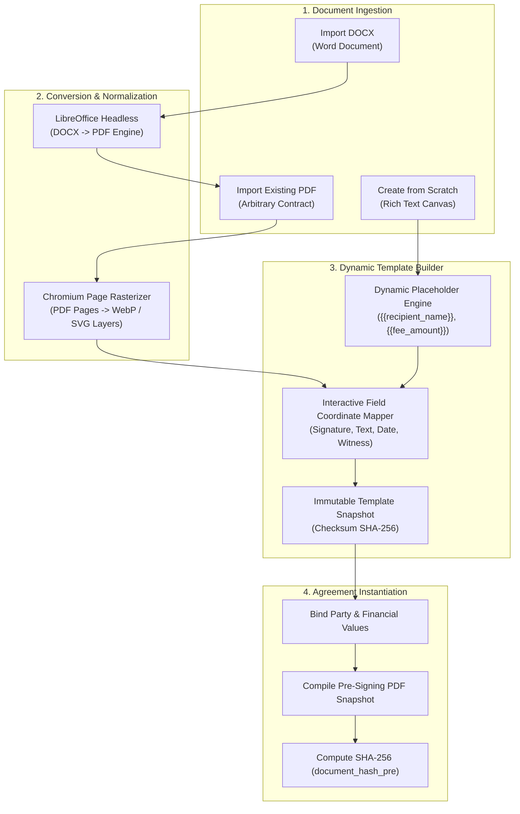
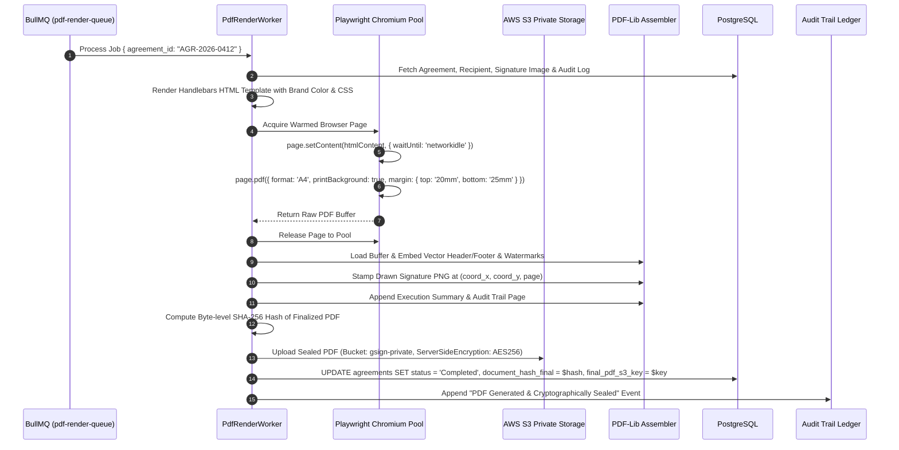
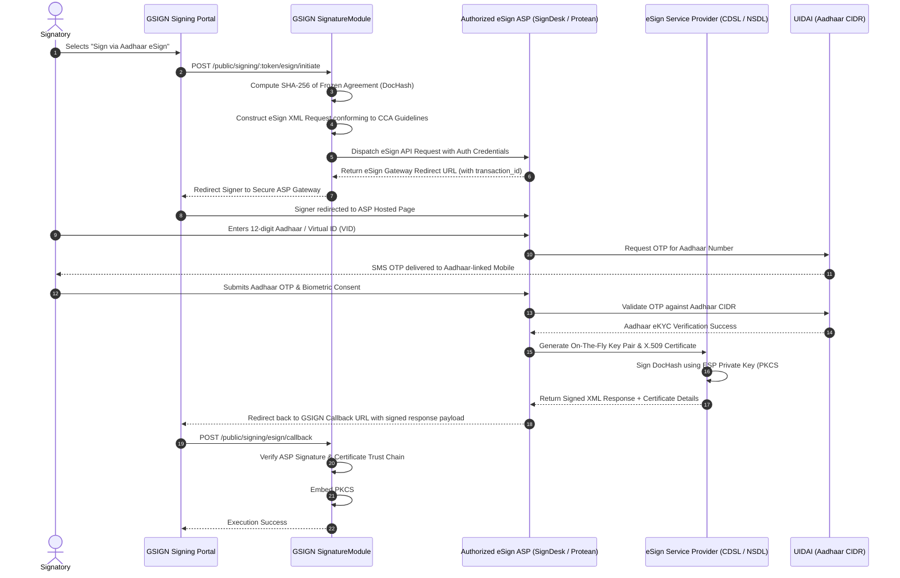
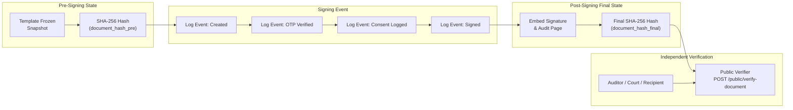

# GSIGN — Document Processing, Cryptographic Integrity & Digital Signature Architecture

**Product:** GSIGN (Digital Agreement Management & Electronic Signature Platform)  
**Legal Framework:** Information Technology Act 2000 (India) — Sections 2(1)(ta), 3, 3A, 5, 10A; Indian Evidence Act 1872 — Section 65B  
**Document Standards:** PDF/A-1b (Archival Standard), PKCS#7 / CMS (Digital Signatures), SHA-256 (Cryptographic Integrity)  
**Rendering Engine:** Headless Chromium (Playwright Pool) + PDF-Lib Vector Assembly

---

## 1. Document Processing & Template Engine Architecture

GSIGN provides two distinct document preparation workflows: **Creating from Scratch (HTML/CSS)** and **Controlled PDF/DOCX Ingestion**.



### 1.1 Technical Evaluation & Realistic Limitations of PDF & DOCX Import
The handover specification requires evaluating PDF/DOCX import. In enterprise software engineering, converting arbitrary DOCX or PDF files into fully editable, clean HTML templates is fraught with technical edge cases. GSIGN addresses these challenges realistically:

1. **DOCX Import Realities & Pipeline:**
   - *Technical Limitation:* Directly converting DOCX into editable HTML/CSS via libraries like `mammoth` or `docx2html` destroys complex multi-column layouts, header/footer margins, nested tables, proprietary fonts, and page numbering.
   - *Architectural Solution:* GSIGN employs **LibreOffice Headless in Docker** to convert imported `.docx` files directly into pixel-perfect `.pdf` documents. The system does not attempt lossy HTML decomposition; it treats the converted PDF as a fixed-layout background layer.
2. **PDF Ingestion & Coordinate Field Mapping:**
   - *Technical Pipeline:* Imported PDFs are parsed using `pdf-lib` and rasterized page-by-page into high-resolution WebP/SVG background layers rendered in the Template Builder.
   - *Field Coordinate Normalization:* The user places fields (Signature, Date, Text) visually over the document. Field coordinates are saved as **relative percentages** rather than fixed pixels:
     ```json
     {
       "field_key": "recipient_signature",
       "page_number": 2,
       "coord_x_pct": 15.25,
       "coord_y_pct": 82.50,
       "width_pct": 32.00,
       "height_pct": 8.50
     }
     ```
     This percentage-based approach ensures identical placement regardless of screen resolution, DPI scaling, or mobile viewports.

---

## 2. Server-Side PDF Generation Engine

In accordance with Section 3 of the developer handover specification, GSIGN rejects fragile client-side PDF compilation (`jspdf`) in production and implements a robust, two-phase server-side PDF pipeline:



### 2.1 Chromium Browser Pre-Warmed Pool
- Launching Chromium on every PDF render request introduces 1.5–2.5 seconds of cold-start latency.
- GSIGN implements a singleton `ChromiumPoolService` maintaining 3–5 persistent, pre-warmed headless browser contexts managed via a queue.
- Memory consumption is tightly managed: each worker process recycles browser instances after 100 PDF renders to prevent V8 heap fragmentation and memory leaks.

---

## 3. Digital Signature Architecture & Indian Legal Framework

Under the Indian **Information Technology Act 2000 (IT Act)**, digital signatures and electronic signatures carry distinct legal standing and evidentiary requirements:

```
┌────────────────────────────────────────────────────────────────────────────────────────┐
│                        INDIAN INFORMATION TECHNOLOGY ACT 2000                          │
├───────────────────────────────────────────┬────────────────────────────────────────────┤
│  SECTION 10A: Basic Electronic Signature  │    SECTION 3 & 3A: Digital Signature       │
│  • Drawn Signature / Finger Touch         │    • Asymmetric Cryptosystem (PKI)         │
│  • Explicit Consent Checkbox              │    • Key Pair & Hash Function              │
│  • 2-Factor OTP Verification              │    • Issued by Licensed Certifying Auth    │
│  • Captured Event Telemetry (IP, UA)      │    • Aadhaar eSign (ASP / ESP Gateway)     │
│  • Suitable for: HR, NDAs, SME Contracts  │    • Class 3 DSC (USB Hardware Token)      │
└───────────────────────────────────────────┴────────────────────────────────────────────┘
```

> [!IMPORTANT]
> **Regulatory Transparency Rule:** The GSIGN interface and audit records must never misrepresent drawn or uploaded signature images as certificate-backed Aadhaar eSign or DSC. Each signature method is explicitly labelled with its true evidentiary classification.

### 3.1 Method 1: Basic Drawn Electronic Signature (Image-Based)
1. Signatory opens the responsive signing portal on mobile or desktop.
2. Signatory reviews the frozen document snapshot.
3. Signatory draws their signature on the HTML5 2D `<canvas>` element (or selects typed script).
4. Signatory marks the mandatory consent checkbox:  
   *`"I have read the full agreement and consent to sign it electronically."`*
5. The signature image is captured as a transparent PNG (`image/png`), uploaded to private S3, and permanently stamped onto the document coordinates.
6. **Evidentiary Weight:** Admissible under Section 10A of the IT Act 2000, supported by electronic attribution evidence (IP, timestamp, OTP verification log).

### 3.2 Method 2: OTP-Verified Electronic Signature
1. Extends Method 1 by enforcing two-factor mobile identity verification before signature execution.
2. Signatory must verify a cryptographically generated 6-digit numeric OTP sent via SMS to their mobile phone.
3. The verified mobile number, SMS gateway transaction reference, and verification timestamp are bound to the document audit trail.

### 3.3 Method 3: Aadhaar eSign Integration Architecture (Authorized ASP)



#### Provider Adapter Architecture (`EsignProviderInterface`)
To avoid vendor lock-in with any single Indian ASP, GSIGN implements a decoupled adapter pattern:

```typescript
export interface EsignInitiateRequest {
  agreementId: string;
  recipientId: string;
  signerName: string;
  signerAadhaarLast4: string;
  documentHash: string;
  callbackUrl: string;
}

export interface EsignInitiateResponse {
  transactionId: string;
  redirectUrl: string;
}

export interface EsignCallbackPayload {
  transactionId: string;
  status: 'SUCCESS' | 'FAILED' | 'REJECTED';
  signedXml?: string;
  pkcs7Signature?: string;
  certificateSerial?: string;
  certificateIssuer?: string;
  signerMaskedAadhaar?: string;
  timestamp: string;
}

export interface EsignProviderInterface {
  readonly providerName: string;
  initiateEsign(request: EsignInitiateRequest): Promise<EsignInitiateResponse>;
  verifyCallback(payload: EsignCallbackPayload): Promise<boolean>;
  downloadSignedDocument(transactionId: string): Promise<Buffer>;
}
```

---

## 4. Cryptographic Document Integrity & Immutable Audit Trail

GSIGN guarantees document integrity using **SHA-256 cryptographic hashing** and an **append-only hash-chained audit ledger**.



### 4.1 Byte-Level SHA-256 Digest Calculation
1. **Timing of Pre-Signing Hash:** Calculated immediately before the agreement invitation is dispatched. Guarantees that the document reviewed by the signer is byte-for-byte identical to the one created by the admin.
2. **Timing of Final Sealed Hash:** Calculated immediately after the headless PDF engine stamps the signatures, letterhead, and audit log.
3. **Calculation Implementation:**
   ```typescript
   import * as crypto from 'crypto';

   export function computeDocumentHash(pdfBuffer: Buffer): string {
     return crypto
       .createHash('sha256')
       .update(pdfBuffer)
       .digest('hex'); // 64 hex characters
   }
   ```

### 4.2 Append-Only Hash-Chained Audit Ledger
Every agreement event records the SHA-256 hash of the immediately preceding event log, creating an unbroken cryptographic hash chain:
$$\text{Current\_Event\_Hash} = \text{SHA-256}(\text{Previous\_Event\_Hash} + \text{Event\_Data} + \text{Timestamp})$$

If an attacker modifies a database record retroactively, the hash chain breaks instantly, triggering a tamper alert in the verification endpoint.

### 4.3 Public Verification Endpoint (`POST /public/verify-document`)
Anyone possessing a signed GSIGN agreement PDF can verify its authenticity without an account:
1. The user uploads the PDF to `https://sign.gsign.in/verify`.
2. The server extracts the embedded agreement reference and calculates the SHA-256 digest of the uploaded file bytes.
3. The server compares the calculated digest against the `document_hash_final` in the PostgreSQL database.
4. If identical, the system confirms:
   - Complete document integrity (zero bytes altered since execution).
   - Signer identity, authentication method, and exact signing timestamp.
   - Compliance with Section 65B of the Indian Evidence Act 1872.
