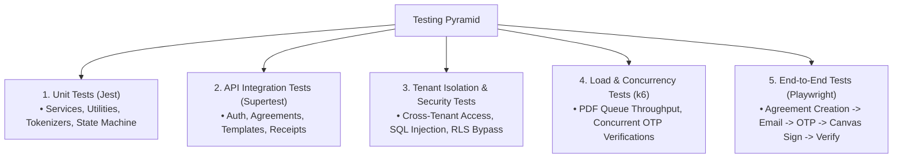

# GSIGN — Phased Implementation Roadmap, Testing Strategy & Governance

**Product:** GSIGN (Digital Agreement Management & Electronic Signature Platform)  
**Product Owner:** Genemax IT Solution Private Limited  
**Founder & CEO:** Sunil G  
**Target Delivery Window:** 18–20 Weeks (Complete Tested Commercial MVP)  
**Governance Standard:** Acceptance Testing Checklist & Milestone Approval Gates (Handover Spec Pages 6–8)

---

## 1. Phased Development Implementation Blueprint

The development roadmap is structured into 7 logical, gated phases prioritizing a secure, functioning multi-tenant core before external third-party integrations:

```mermaid
gantt
    title GSIGN Engineering Implementation Roadmap (Weeks 1 to 20)
    dateFormat  WW
    axisFormat  Wk %W

    section Phase 1: Core Platform
    Database Schema, RLS & Migrations       :p1_1, 01, 2w
    Auth, MFA & Multi-Tenant Middleware     :p1_2, 02, 2w

    section Phase 2: Template Engine
    Template Builder & Coordinate Mapper    :p2_1, 04, 2w
    PDF/DOCX Ingestion & Storage Service    :p2_2, 05, 2w

    section Phase 3: Agreement Engine
    Agreement Lifecycle & State Machine     :p3_1, 07, 2w
    Public Recipient Portal & OTP Service   :p3_2, 08, 2w

    section Phase 4: PDF & Cryptography
    Headless Chromium PDF Rendering Pool    :p4_1, 10, 2w
    SHA-256 Hashing, Tamper Proof & Receipts:p4_2, 11, 2w

    section Phase 5: eSign Sandbox
    Indian Aadhaar eSign ASP Gateway        :p5_1, 13, 2w
    DSC USB Token PKI Verification          :p5_2, 14, 2w

    section Phase 6: SaaS & Admin
    Subscriptions, Metering & Razorpay      :p6_1, 16, 2w
    Super Admin Console & Custom Domains    :p6_2, 16, 2w

    section Phase 7: Hardening & Go-Live
    Security Audit, RLS Penetration Testing :p7_1, 18, 2w
    Production Deploy & Final Handover Gate :p7_2, 19, 2w
```

---

### Detailed Phase Breakdown

#### Phase 1: Core Platform, Multi-tenancy & Authentication (Weeks 1–3)
- **Objective:** Establish the foundational backend architecture, database schema, strict PostgreSQL RLS tenant isolation, and administrative authentication.
- **Modules Included:** `AuthModule`, `UserModule`, `TenantModule`, `RolePermissionModule`.
- **Dependencies:** PostgreSQL 16+, Redis 7+.
- **Concrete Deliverables:**
  - Automated database migration scripts creating all 28 tables, foreign keys, and indexes.
  - PostgreSQL Row-Level Security policies active across all tenant entities.
  - NestJS `TenantContextMiddleware` and `TenantTransactionService`.
  - User login, Argon2id password hashing, and RFC 6238 TOTP admin MFA.
  - RBAC guards enforcing permissions.
- **Acceptance Criteria:**
  - Company A admin cannot read, modify, or list Company B users under any circumstance.
  - Passing all automated cross-tenant security unit and integration tests.
  - MFA login flow functioning cleanly with Google Authenticator and recovery codes.

#### Phase 2: Template Builder, Document Ingestion & Storage (Weeks 4–6)
- **Objective:** Implement dynamic template creation, versioning, placeholder tokenization, field coordinate mapping, and private S3 storage.
- **Modules Included:** `TemplateModule`, `DocumentProcessingModule`, `StorageModule`.
- **Dependencies:** Phase 1 complete, AWS S3 / MinIO.
- **Concrete Deliverables:**
  - CRUD APIs for templates and template versions.
  - Relative percentage-based coordinate storage for interactive fields.
  - Dynamic token extraction and replacement engine (`{{recipient_name}}`, `{{fee_amount}}`).
  - Private S3 upload and pre-signed download URL service.
- **Acceptance Criteria:**
  - Editing a template increments the version number without altering previously sent agreements.
  - Field coordinates correctly normalize across desktop and mobile aspect ratios.

#### Phase 3: Agreement Engine, Recipient Verification & Basic Signing (Weeks 7–9)
- **Objective:** Implement agreement creation, dispatching, high-entropy token hashing, public recipient signing portal, SMS OTP verification, and canvas signature capture.
- **Modules Included:** `AgreementModule`, `AgreementLifecycleModule`, `SignatureModule`, `OtpVerificationModule`, `NotificationModule`.
- **Dependencies:** Phase 1 & 2 complete, SMS Gateway account (Twilio / MSG91).
- **Concrete Deliverables:**
  - Agreement creation endpoint with recipient designation.
  - High-entropy signing link generation storing SHA-256 token hashes.
  - Public signing portal APIs: OTP dispatch, attempt verification, 60s cooldown, session binding.
  - Canvas signature upload, legal consent checkbox logging, and state transition to `Completed`.
- **Acceptance Criteria:**
  - Submitting incorrect OTP 3 times locks the session for 30 minutes.
  - Re-opening a signed agreement link displays the completed confirmation screen and blocks re-signing.

#### Phase 4: Server-Side PDF Engine, Cryptographic Integrity & Receipts (Weeks 10–12)
- **Objective:** Replace client-side `jspdf` with headless Playwright/Chromium rendering, byte-level SHA-256 document hashing, hash-chained audit trails, and receipt voucher generation.
- **Modules Included:** `PdfGenerationModule`, `AuditTrailModule`, `ReceiptModule`, `BackgroundJobModule`.
- **Dependencies:** Phase 3 complete, BullMQ worker containers.
- **Concrete Deliverables:**
  - Headless Chromium pre-warmed pool rendering multi-page A4 PDFs with headers, footers, and margins.
  - Automated calculation and storage of `document_hash_pre` and `document_hash_final`.
  - Public verification endpoint (`POST /api/v1/public/verify-document`).
  - Financial receipt voucher generation on authorized admin payment acknowledgement.
- **Acceptance Criteria:**
  - Generated PDF byte hash matches database record exactly. Modifying a single byte in the PDF causes the public verification endpoint to report `tamper_detected: true`.
  - Agreement submission alone never issues a receipt until explicit admin acknowledgement occurs.

#### Phase 5: Verified Indian eSign & DSC Integration Sandbox (Weeks 13–15)
- **Objective:** Implement provider-independent adapter architecture for certified Indian digital signatures (Aadhaar eSign and Class 3 DSC).
- **Modules Included:** `SignatureModule` (eSign ASP extensions), `EsignProviderFactory`.
- **Dependencies:** Phase 4 complete, ASP Sandbox agreement (SignDesk / Protean).
- **Concrete Deliverables:**
  - `EsignProviderInterface` implementation for Indian ASP.
  - Sandbox flow for Aadhaar OTP authentication and on-the-fly certificate issuance.
  - PKCS#7 detached signature verification and PDF embedding.
- **Acceptance Criteria:**
  - Complete eSign round-trip execution in sandbox with verified X.509 certificate chain.
  - Clear UI distinction: drawn signatures are never mislabeled as certificate-backed eSign.

#### Phase 6: SaaS Billing, Usage Quotas & Super Admin (Weeks 16–17)
- **Objective:** Multi-tenant billing, plan quota enforcement, overage calculation, custom domain CNAME verification, and Super Admin oversight.
- **Modules Included:** `SubscriptionModule`, `UsageQuotaModule`, `BrandingDomainModule`, `SuperAdminModule`.
- **Dependencies:** Razorpay / Stripe sandbox, Cloudflare API credentials.
- **Concrete Deliverables:**
  - Super Admin tenant management and global pricing matrix APIs.
  - Automated monthly document usage metering and plan limit enforcement.
  - Custom domain CNAME verification and SSL automation.
  - Support session logging for Super Admin access to tenant data.
- **Acceptance Criteria:**
  - Tenants exceeding monthly document limits are blocked or billed overage according to plan rules.
  - Super Admin support access cannot occur without logging a mandatory reason code.

#### Phase 7: Security Hardening, Penetration Testing & Production Launch (Weeks 18–20)
- **Objective:** Rigorous security testing, load testing, disaster recovery rehearsal, and production handover.
- **Dependencies:** All previous phases complete.
- **Concrete Deliverables:**
  - Third-party penetration testing and vulnerability remediation.
  - Load testing (500 concurrent signing sessions, 50 concurrent PDF renders).
  - Disaster recovery rehearsal (database restoration from backup within 1 hour).
  - Comprehensive API documentation (Swagger / OpenAPI 3.0).
  - Production deployment to AWS Mumbai (`ap-south-1`).
- **Acceptance Criteria:**
  - Zero critical or high-severity vulnerabilities.
  - Product owner written sign-off on production readiness.

---

## 2. Comprehensive Quality Assurance & Testing Strategy

GSIGN enforces a multi-layered testing strategy incorporating unit, integration, RLS security, and end-to-end tests:



### 2.1 Critical Negative Security Tests (Automated)

The test suite must explicitly assert failure on the following negative attack vectors:

1. **Cross-Tenant Document Access:**
   - *Test:* User A (Tenant 1) attempts `GET /api/v1/agreements/AGR-TENANT-2-001`.
   - *Assertion:* PostgreSQL RLS intercepts query; returns `404 Not Found`.
2. **Unauthorized Cross-Tenant Modification:**
   - *Test:* User A attempts `PATCH /api/v1/branding` with `tenant_id` of Tenant B in the payload.
   - *Assertion:* Request context rejects foreign tenant ID; RLS blocks update; returns `403 Forbidden`.
3. **Tampered PDF Verification:**
   - *Test:* Download a completed agreement PDF, alter 1 character in the text stream, and submit to `POST /api/v1/public/verify-document`.
   - *Assertion:* Calculated SHA-256 hash does not match `document_hash_final`; returns `tamper_detected: true`.
4. **Expired / Replayed Signing Token:**
   - *Test:* Sign an agreement, then attempt to submit another signature using the same token URL.
   - *Assertion:* Token is marked as completed; returns `400 Bad Request ("Document already executed")`.
5. **Brute-Force OTP Lockout:**
   - *Test:* Submit 3 consecutive invalid OTP codes to `/api/v1/public/signing/:token/otp/verify`.
   - *Assertion:* 4th attempt returns `429 Too Many Requests ("Session locked for 30 minutes")`.

---

## 3. Comprehensive Technical Risk Matrix & Mitigations

| Risk | Impact | Probability | Mitigation Strategy |
|---|:---:|:---:|---|
| **Indian DLT SMS Template Delays** | High | High | Initiate Telecom Commercial Communications Customer Preference Regulations (TCCCPR) DLT entity registration in Week 1 with MSG91/Jio/Airtel to avoid blocking SMS OTP delivery. |
| **Aadhaar eSign ASP Onboarding Lag** | High | Medium | Implement basic drawn signature and OTP verification first (Phases 1–4). Build eSign provider gateway as an isolated adapter that can be plugged in once ASP commercial approval is granted. |
| **Chromium PDF Render Memory Spikes** | High | Medium | Run Playwright rendering in an isolated Fargate worker pool with strict task memory limits (4 GB) and automatic worker recycling after 100 renders. |
| **Cross-Tenant Data Leakage** | Critical | Low | Enforce defense-in-depth: Application-level tenant checks combined with mandatory PostgreSQL Row-Level Security (RLS) on all tenant-partitioned tables. |
| **DOCX Import Formatting Breakages** | Medium | High | Use headless LibreOffice inside Docker to convert DOCX to PDF backgrounds rather than attempting lossy DOCX-to-HTML conversion. |

---

## 4. Unresolved Decisions Requiring Product Owner Approval

Before beginning backend development, the Product Owner (Sunil G) must provide written guidance on the following commercial and operational decisions:

1. **Aadhaar eSign Commercial Partner Selection:**
   - *Decision:* Which authorized Indian ASP should be selected for the commercial contract (e.g. SignDesk, Protean/NSDL, eMudhra, or CDSL)?
2. **TRAI DLT Entity Registration:**
   - *Decision:* Genemax IT Solution Private Limited must register its registered business entity, Principal Entity ID (PE ID), and approved SMS header (e.g., `GNMSGN`) on an Indian telecom DLT portal for transactional OTP delivery.
3. **Custom Domain Routing Architecture:**
   - *Decision:* Will white-label custom domains be managed via Cloudflare for SaaS (automated SSL via API) or manual DNS CNAME mapping to AWS Application Load Balancer?
4. **Receipt Sequential Numbering Scheme:**
   - *Decision:* Should receipt numbering follow a platform-wide sequence (`RCT-0091`) or a tenant-scoped sequence (`GSIGN-2026-RCT-0001`) for accounting compliance?
5. **Statutory Document Retention Policy:**
   - *Decision:* What is the default retention period for completed agreements (e.g. 7 years under Indian Companies Act vs. indefinite until tenant cancellation)?

---

## 5. Immediate Next Implementation Milestone

Upon written approval of this architecture blueprint, the development team will immediately execute:

**Milestone 1 — Core Infrastructure, Database & Authentication Setup (Weeks 1–3)**
1. Initialize NestJS monorepo with strict TypeScript configuration and Docker Compose development stack.
2. Execute PostgreSQL database migrations for all 28 entities and configure Row-Level Security policies.
3. Implement `TenantContextMiddleware`, Argon2id password hashing, and RFC 6238 TOTP admin MFA.
4. Deliver automated test suite demonstrating complete tenant isolation across two test companies (Company A and Company B).
