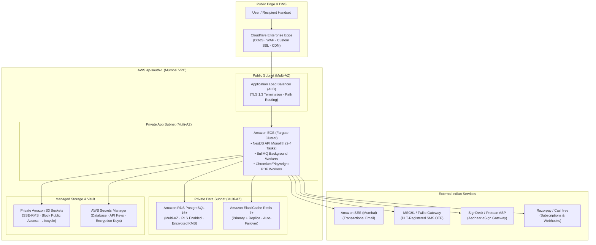

# GSIGN — Production Infrastructure, Deployment & Cost Blueprint

**Product:** GSIGN (Digital Agreement Management & Electronic Signature Platform)  
**Target Market:** India First, International Expansion Architecture  
**Regulatory Standards:** Digital Personal Data Protection Act 2023 (DPDP Act, India), CERT-In Cyber Security Directions (2022)  
**Primary Region:** `ap-south-1` (AWS Mumbai, India) — Mandatory for Indian Data Localization

---

## 1. Production Deployment Topology



---

## 2. Technology Stack Evaluation & Component Phasing

To balance rapid time-to-market with enterprise reliability, components are categorized into **Mandatory MVP (Phase 1–4)** and **Deferred / Scale Components (Phase 5+)**:

| Component | Technology Selected | Evaluation Summary | Phasing Category |
|---|---|---|:---:|
| **API Runtime** | Node.js 22 LTS + NestJS 10 | High async I/O throughput, TypeScript ecosystem, native dependency injection, clean modular architecture. | **Mandatory MVP** |
| **Primary Database** | PostgreSQL 16+ | Enterprise relational integrity, native Row-Level Security (RLS) for tenant isolation, JSONB support for dynamic fields. | **Mandatory MVP** |
| **Cache & Queues** | Redis 7+ with BullMQ | Low-latency session management, OTP rate-limiting counters, robust distributed task queue with retry logic. | **Mandatory MVP** |
| **Object Storage** | Private S3 / MinIO | Encrypted blob store for PDF snapshots, signature PNGs, and template assets. Zero public read access; signed URLs only. | **Mandatory MVP** |
| **PDF Engine** | Playwright / Chromium Pool | Pixel-perfect headless HTML/CSS rendering; supports Indian typography, dynamic multi-page flows, and margins. | **Mandatory MVP** |
| **Transactional Email** | Amazon SES (Mumbai) | High deliverability, native AWS VPC integration, local Mumbai routing, cost-effective transactional notifications. | **Mandatory MVP** |
| **SMS OTP Gateway** | MSG91 (DLT Approved) | Mandatory Indian Telecom Regulatory Authority (TRAI) Distributed Ledger Technology (DLT) template compliance for SMS OTP delivery. | **Mandatory MVP** |
| **eSign ASP Integration** | SignDesk / Protean ASP | Certified Indian Application Service Provider (ASP) for Aadhaar-based OTP and biometric electronic signatures. | **Phase 5 Deferred** |
| **Payment Gateway** | Razorpay Subscriptions | Recurring SaaS billing support for Indian credit cards, net banking, UPI AutoPay, and GST invoices. | **Phase 6 Deferred** |
| **Kubernetes (EKS)** | Amazon EKS | Unnecessary operational overhead for initial launch. Containerized ECS Fargate provides identical isolation with zero cluster management. | **Deferred (Post-MVP)** |

---

## 3. Plan A: Development & Testing Deployment

**Objective:** Zero/minimal cloud cost, reproducible local development environment, offline sandboxes for testing.

```
┌────────────────────────────────────────────────────────────────────────┐
│                        DOCKER COMPOSE LOCAL STACK                      │
│                                                                        │
│  ┌───────────────────────┐    ┌──────────────────────┐   ┌──────────┐  │
│  │   NestJS API (:3000)  │<-->│   PostgreSQL 16      │   │  Redis 7 │  │
│  │   (Hot Reload / Ts)   │    │   (RLS Configured)   │   │  (:6379) │  │
│  └───────────────────────┘    └──────────────────────┘   └──────────┘  │
│             │                            │                      │      │
│             ▼                            ▼                      ▼      │
│  ┌───────────────────────┐    ┌──────────────────────┐   ┌──────────┐  │
│  │   MinIO Object Store  │    │   MailHog (SMTP)     │   │ Mock SMS │  │
│  │   (Local S3 API :9000)│    │   (Web Mailbox :8025)│   │ Sandbox  │  │
│  └───────────────────────┘    └──────────────────────┘   └──────────┘  │
└────────────────────────────────────────────────────────────────────────┘
```

- **Local Storage:** MinIO container providing standard S3 API on `http://localhost:9000`.
- **Local Mailer:** MailHog intercepts all outgoing emails on port `1025` and provides a web UI on `http://localhost:8025`.
- **Local SMS/OTP:** Simulated via an internal NestJS mock provider that logs OTP codes to the terminal console (`[DEV OTP]: 482190`).
- **Local eSign:** Simulated eSign sandbox returning pre-configured mock X.509 PKCS#7 signatures.
- **Estimated Cost:** **₹0 / month** (Runs entirely on developer hardware).

---

## 4. Plan B: Enterprise Production Deployment (AWS Mumbai)

**Objective:** High availability (99.9% uptime SLA), disaster recovery, strict tenant isolation, compliance with Indian data sovereignty laws.

### 4.1 Networking & Security Configuration
- **VPC Configuration:** Multi-AZ VPC (`ap-south-1a`, `ap-south-1b`) with 2 Public Subnets (NAT Gateways, ALB) and 4 Private Subnets (App & Database tiers).
- **Zero Ingress to Databases:** PostgreSQL and Redis reside in isolated private subnets with no public IP addresses or internet routing.
- **WAF & Edge Security:** Cloudflare Enterprise edge handles DDoS mitigation, TLS 1.3 termination, rate limiting, and automated SSL for custom tenant domains.

### 4.2 Compute & Container Strategy
- **Container Runtime:** Amazon ECS with AWS Fargate (Serverless container execution).
- **API Task Sizing:** 2 vCPU / 4 GB RAM per task. Minimum 2 tasks across distinct Availability Zones; auto-scaling up to 8 tasks based on CPU/Memory thresholds.
- **Dedicated PDF Worker Tasks:** Separate Fargate service dedicated to CPU-intensive Playwright/Chromium rendering tasks, ensuring PDF compilation spikes never degrade REST API responsiveness.

### 4.3 Data Protection & Storage Hardening
- **Private S3 Buckets:** `gsign-documents-prod` and `gsign-signatures-prod`.
  - Block Public Access: Enabled on all 4 settings.
  - Server-Side Encryption: AWS KMS Customer Managed Key (`arn:aws:kms:ap-south-1:...`).
  - S3 Object Lock: Compliance mode enabled for executed agreements (WORM — Write Once, Read Many).
  - Pre-Signed URLs: Generated with maximum 15-minute expiration window.

---

## 5. Security, Compliance & Data Residency (DPDP Act India)

The Digital Personal Data Protection Act 2023 (DPDP) imposes strict obligations on digital data fiduciaries in India:

1. **Indian Data Localization:** All agreement documents, signer names, Aadhaar verification logs, phone numbers, and signatures must be stored strictly within Indian borders. AWS Mumbai (`ap-south-1`) fulfills this requirement.
2. **Purpose Limitation & Data Minimization:** GSIGN collects only the fields specified in the agreement template. The recipient portal displays explicit legal notices detailing data processing terms.
3. **Right to Erasure & Data Retention:** 
   - Non-executed draft agreements can be purged by tenant administrators.
   - Legally executed agreements are bound by statutory retention policies (e.g. 7 years under Indian commercial statutes) and are protected from unauthorized deletion.
4. **CERT-In Compliance:** System security logs, authentication attempts, and administrative actions are retained in an immutable log repository for 180 days, compliant with CERT-In directions.

---

## 6. Comprehensive Cost Model & Infrastructure Projections

The following table provides realistic operational cost estimates for hosting GSIGN in production:

| Category | Service / Infrastructure Provider | Architecture Purpose | Base Monthly Cost (Estimated) | Usage / Variable Cost Drivers |
|---|---|---|---|---|
| **Compute** | AWS ECS Fargate (4 Tasks) | API Monolith + PDF Workers | ₹12,000 – ₹18,000 | Scales with vCPU / RAM hours as document volume grows. |
| **Database** | Amazon RDS PostgreSQL (db.t4g.medium) | Multi-AZ Primary Database with RLS | ₹8,000 – ₹12,000 | Storage auto-growth (SSD gp3). |
| **Cache & Queue** | Amazon ElastiCache Redis (cache.t4g.small) | Session Cache & BullMQ Queues | ₹3,500 – ₹5,000 | Minimal scaling needed for initial 10,000 docs/mo. |
| **Object Storage** | Amazon S3 Standard (ap-south-1) | Encrypted Document Store | ₹1,000 – ₹2,500 | ₹1.90 / GB / month storage + PUT/GET API calls. |
| **Edge & Security** | Cloudflare Pro / Business | WAF, DDoS & Custom Domain SSL | ₹2,000 – ₹16,000 | Standard plan covers custom domains and edge SSL. |
| **Transactional Email** | Amazon SES (ap-south-1) | Signing Invites & Sealed PDFs | ₹500 – ₹1,500 | ₹8.00 per 1,000 emails sent. |
| **SMS OTP Gateway** | MSG91 (DLT Compliant) | 2FA Recipient OTP Verification | Pay-as-you-go | ₹0.18 – ₹0.25 per SMS delivered in India. |
| **Aadhaar eSign ASP** | SignDesk / Protean ASP | Certified eSign Execution | Commercial Agreement | ₹15.00 – ₹25.00 per successful Aadhaar eSign. |
| **Total Base Monthly** | **Core Infrastructure Subtotal** | **Production Baseline** | **₹27,000 – ₹40,000 / month** | *Usage-based SMS & eSign billed directly to tenants.* |

*(Note: Hardware and third-party fees are estimated based on prevailing market rates in India and are subject to commercial contract negotiations with providers).*
