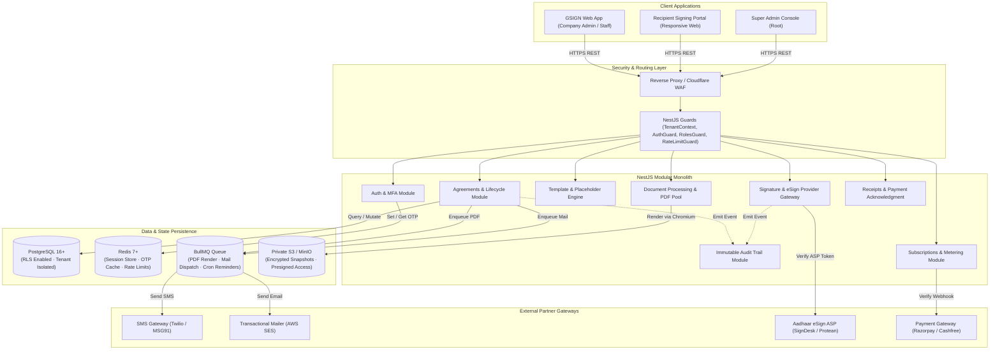
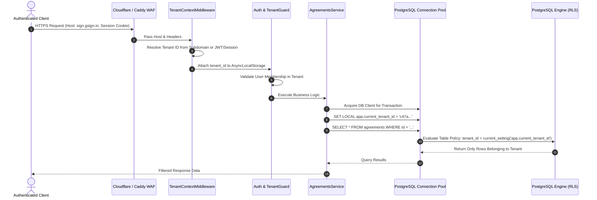

# GSIGN — System Architecture Blueprint

**Product Name:** GSIGN (Digital Agreement Management & Electronic Signature Platform)  
**Product Owner:** Genemax IT Solution Private Limited  
**Founder & CEO:** Sunil G  
**Document Version:** 1.0.0 (Release-Ready Architecture Blueprint)  
**Target Architecture:** Node.js / NestJS Modular Monolith, PostgreSQL with Row-Level Security (RLS), Redis / BullMQ, Private S3-Compatible Storage  
**Primary Standards:** Final Software Development & Technical Handover Specification (v1.0), Information Technology Act 2000 (India), Digital Personal Data Protection Act 2023 (DPDP)

---

## 1. Executive Architectural Overview

GSIGN is architected as an **enterprise-grade, multi-tenant digital agreement and electronic signature platform** designed for commercial scalability, regulatory compliance in India, and future international expansion. 

The architecture strictly follows a **Modular Monolith pattern** built on **TypeScript, Node.js, and NestJS**. It decisively rejects premature microservices while preserving clean module boundaries, tenant encapsulation, decoupled provider gateways, and event-driven asynchronous processing.

### Key Architectural Pillars

```
┌────────────────────────────────────────────────────────────────────────────────────────┐
│                                 GSIGN REACT 19 FRONTEND                                │
│                     (Vite · TypeScript · Tailwind CSS · 2D Minimal)                    │
└───────────────────────────────────────────┬────────────────────────────────────────────┘
                                            │ HTTPS / WSS
                                            ▼
┌────────────────────────────────────────────────────────────────────────────────────────┐
│                             NESTJS MODULAR MONOLITH (API)                              │
│                                                                                        │
│  [ Global Guards & Interceptors: Helmet · RateLimiter · TenantContext · AuditInterceptor ]
│                                                                                        │
│  ┌───────────────────────┬─────────────────────────┬────────────────────────────────┐  │
│  │   Core & Auth Domain  │  Agreement & Doc Engine │   Commercial & Admin Domain    │  │
│  │  • Auth & Admin MFA   │  • Agreement Lifecycle  │  • Tenant & Subscription Mgmt  │  │
│  │  • Tenant & User Mgmt │  • Template Builder     │  • Quotas & Usage Metering     │  │
│  │  • RBAC & Permissions │  • Document Processing  │  • Receipts & Acknowledgements │  │
│  │  • Audit Trail Ledger │  • PDF Rendering Pool   │  • Branding & Custom Domains   │  │
│  │  • Recipient OTP Auth │  • Signature & eSign GW │  • Super Admin Root Control    │  │
│  └───────────────────────┴─────────────────────────┴────────────────────────────────┘  │
└─────────────────────────────┬───────────────────────────┬──────────────────────────────┘
                              │                           │
          ┌───────────────────┴──────────┐   ┌────────────┴──────────────────────┐
          ▼                              ▼   ▼                                   ▼
┌──────────────────┐          ┌──────────────────┐          ┌────────────────────────────┐
│    POSTGRESQL    │          │  REDIS & BULLMQ  │          │    PRIVATE OBJECT STORE    │
│  • Row-Level Sec │          │  • Session Cache │          │    (AWS S3 / MinIO)        │
│  • Tenant Scope  │          │  • PDF Job Queue │          │  • Server-Side Encryption  │
│  • Immutable Log │          │  • OTP / RateLim │          │  • Expiring Presigned URLs │
│  • UUIDv7 Keys   │          │  • Email Remind  │          │  • Zero Public Exposure    │
└──────────────────┘          └──────────────────┘          └────────────────────────────┘
```

---

## 2. Monolith Justification vs. Microservices

The handover specification (Section 3) explicitly dictates:  
> *"Start with a modular monolith; avoid premature microservices. Every tenant-owned record and operation must enforce tenant scope across APIs, database, storage, exports, support tools and background jobs."*

### Technical Justification

1. **Transactional Integrity & Document Concurrency:**  
   Agreement creation, party field binding, document snapshot hashing, and audit log generation require atomic ACID database transactions. In a distributed microservice architecture, ensuring data consistency across multiple databases would require complex distributed sagas, 2-phase commits, and significant network latency.
2. **PostgreSQL Row-Level Security (RLS) Cohesion:**  
   PostgreSQL RLS enforces tenant boundaries in the database kernel using transaction-local session variables (`app.current_tenant_id`). A unified database schema enables database-level security guarantees across all domain entities (Users, Templates, Agreements, Documents, Receipts, Invoices) that microservice data silos cannot deliver.
3. **Operational Overhead & Cost Control:**  
   Microservices require multi-repo or complex mono-repo CI/CD pipelines, service meshes, distributed tracing, Kubernetes orchestration, and inter-service authentication. For an India-first commercial SaaS targeting 14–18 week MVP delivery, a NestJS modular monolith provides the cleanest developer velocity and lowest hosting overhead while maintaining strict module isolation.
4. **Boundary Isolation through NestJS Modules:**  
   Each NestJS module encapsulates its own controllers, services, repositories, and domain events. Internal communication between modules occurs via typed service injection or in-process EventEmitter, allowing extraction into microservices in the future if document throughput demands independent horizontal scaling.

---

## 3. High-Level Communication & Data Flow



---

## 4. Comprehensive Backend Module Architecture (20 Modules)

The NestJS backend application is organized into 20 cohesive, loosely-coupled modules:

```mermaid
graph TD
    AppModule --> TenantModule
    AppModule --> AuthModule
    AppModule --> UserModule
    AppModule --> RolePermissionModule
    AppModule --> TemplateModule
    AppModule --> AgreementModule
    AppModule --> AgreementLifecycleModule
    AppModule --> DocumentProcessingModule
    AppModule --> PdfGenerationModule
    AppModule --> SignatureModule
    AppModule --> OtpVerificationModule
    AppModule --> AuditTrailModule
    AppModule --> ReceiptModule
    AppModule --> PaymentModule
    AppModule --> SubscriptionModule
    AppModule --> UsageQuotaModule
    AppModule --> BrandingDomainModule
    AppModule --> NotificationModule
    AppModule --> BackgroundJobModule
    AppModule --> SuperAdminModule

    AgreementLifecycleModule --> AgreementModule
    AgreementLifecycleModule --> DocumentProcessingModule
    AgreementLifecycleModule --> SignatureModule
    AgreementLifecycleModule --> AuditTrailModule
    AgreementLifecycleModule --> NotificationModule

    DocumentProcessingModule --> PdfGenerationModule
    SignatureModule --> OtpVerificationModule
    ReceiptModule --> PaymentModule
    UsageQuotaModule --> SubscriptionModule
```



### 1. Authentication Module (`AuthModule`)
- **Responsibilities:** Session issuance, credential verification, admin login, refresh token rotation, logout, CSRF token handling, and MFA verification.
- **Main Services:** `AuthService`, `SessionService`, `TotpService`.
- **Controllers:** `AuthController` (`/api/v1/auth`).
- **Database Entities:** `User`, `TenantMembership`, `Session`, `UserMfaConfig`.
- **Dependencies:** `UserModule`, `TenantModule`, `BackgroundJobModule`, `RedisModule`.
- **Exposed APIs:** `POST /login`, `POST /verify-mfa`, `POST /logout`, `POST /refresh-session`, `POST /forgot-password`, `POST /reset-password`.

### 2. Users Module (`UserModule`)
- **Responsibilities:** User profile management, security settings, password changes, tenant profile settings.
- **Main Services:** `UserService`, `UserSecurityService`.
- **Controllers:** `UserController` (`/api/v1/users`).
- **Database Entities:** `User`, `TenantMembership`.
- **Dependencies:** `TenantModule`, `RolePermissionModule`.
- **Exposed APIs:** `GET /me`, `PATCH /me`, `PUT /me/password`, `POST /me/mfa/setup`, `POST /me/mfa/verify`.

### 3. Roles & Permissions Module (`RolePermissionModule`)
- **Responsibilities:** RBAC enforcement, permission lookup, custom role assignments within tenants.
- **Main Services:** `RoleService`, `PermissionService`, `RbacGuard`.
- **Controllers:** `RoleController` (`/api/v1/roles`).
- **Database Entities:** `Role`, `Permission`, `RolePermission`, `TenantMembership`.
- **Dependencies:** `TenantModule`.
- **Exposed APIs:** `GET /roles`, `POST /roles`, `PUT /roles/:id`, `DELETE /roles/:id`, `GET /permissions`.

### 4. Tenants Module (`TenantModule`)
- **Responsibilities:** Tenant lifecycle, organization settings, tenant context extraction, user invitation management.
- **Main Services:** `TenantService`, `TenantContextService`, `InvitationService`.
- **Controllers:** `TenantController` (`/api/v1/tenants`), `InvitationController` (`/api/v1/invitations`).
- **Database Entities:** `Tenant`, `TenantMembership`, `Invitation`.
- **Dependencies:** `SubscriptionModule`, `NotificationModule`.
- **Exposed APIs:** `GET /tenants/current`, `PATCH /tenants/current`, `POST /invitations`, `GET /invitations`, `DELETE /invitations/:id`, `POST /invitations/:token/accept`.

### 5. Agreements Module (`AgreementModule`)
- **Responsibilities:** Agreement ledger querying, filtering by status/type/department, agreement creation, search, CSV export.
- **Main Services:** `AgreementService`, `AgreementExportService`.
- **Controllers:** `AgreementController` (`/api/v1/agreements`).
- **Database Entities:** `Agreement`, `AgreementRecipient`, `AgreementField`, `AgreementVersion`.
- **Dependencies:** `TenantModule`, `AuditTrailModule`, `UsageQuotaModule`.
- **Exposed APIs:** `GET /agreements`, `POST /agreements`, `GET /agreements/:id`, `GET /agreements/:id/export-csv`.

### 6. Agreement Lifecycle Module (`AgreementLifecycleModule`)
- **Responsibilities:** Orchestrating the strict agreement state machine: draft -> sent -> viewed -> OTP verified -> signed -> completed / rejected / expired / cancelled.
- **Main Services:** `AgreementLifecycleService`, `AgreementExpiryService`.
- **Controllers:** `AgreementLifecycleController` (`/api/v1/agreements/:id/lifecycle`).
- **Database Entities:** `Agreement`, `AgreementEvent`, `AgreementVersion`.
- **Dependencies:** `AgreementModule`, `DocumentProcessingModule`, `SignatureModule`, `AuditTrailModule`, `NotificationModule`, `ReceiptModule`.
- **Exposed APIs:** `POST /agreements/:id/send`, `POST /agreements/:id/cancel`, `POST /agreements/:id/remind`.

### 7. Templates Module (`TemplateModule`)
- **Responsibilities:** Agreement template creation, versioning, placeholder definitions, field coordinate mappings, template publishing.
- **Main Services:** `TemplateService`, `TemplateVersionService`, `PlaceholderParserService`.
- **Controllers:** `TemplateController` (`/api/v1/templates`).
- **Database Entities:** `Template`, `TemplateVersion`, `TemplateField`.
- **Dependencies:** `TenantModule`, `DocumentProcessingModule`.
- **Exposed APIs:** `GET /templates`, `POST /templates`, `GET /templates/:id`, `PUT /templates/:id`, `POST /templates/:id/publish`, `POST /templates/:id/versions/:ver/preview`.

### 8. Document Processing Module (`DocumentProcessingModule`)
- **Responsibilities:** Ingesting PDF/DOCX templates, extracting structure, freezing immutable document snapshots before signing, binding signer inputs.
- **Main Services:** `DocumentService`, `DocumentSnapshotService`, `DocxConversionService`.
- **Controllers:** `DocumentController` (`/api/v1/documents`).
- **Database Entities:** `Document`, `DocumentVersion`.
- **Dependencies:** `PdfGenerationModule`, `StorageModule`.
- **Exposed APIs:** `POST /documents/import`, `GET /documents/:id/snapshot`, `GET /documents/:id/download`.

### 9. PDF Generation Module (`PdfGenerationModule`)
- **Responsibilities:** Headless Chromium rendering of HTML/CSS agreement templates, vector stamping, PDF-Lib multi-page assembly, headers, footers, pagination, watermarking.
- **Main Services:** `ChromiumPoolService`, `PdfAssemblyService`.
- **Controllers:** None (Internal service invoked via queues and direct calls).
- **Database Entities:** `DocumentVersion`.
- **Dependencies:** `StorageModule`.
- **Exposed APIs:** Internal Service APIs (`generatePdfFromHtml`, `stampSignaturesAndAudit`).

### 10. Signature Module (`SignatureModule`)
- **Responsibilities:** Capturing drawn signatures, processing explicit consent checkboxes, verifying identity, orchestrating Aadhaar eSign ASP or DSC workflows.
- **Main Services:** `SignatureService`, `EsignProviderFactory`, `DscValidationService`.
- **Controllers:** `PublicSigningController` (`/api/v1/public/signing`).
- **Database Entities:** `Signature`, `SigningSession`, `ConsentRecord`.
- **Dependencies:** `OtpVerificationModule`, `DocumentProcessingModule`, `AuditTrailModule`.
- **Exposed APIs:** `GET /public/signing/:token`, `POST /public/signing/:token/consent`, `POST /public/signing/:token/submit-signature`, `POST /public/signing/esign/callback`.

### 11. OTP Verification Module (`OtpVerificationModule`)
- **Responsibilities:** Generating cryptographically secure 6-digit numeric OTPs, Redis TTL caching, delivery dispatch via SMS, attempt validation, rate limiting, and brute-force lockout.
- **Main Services:** `OtpService`, `SmsDispatchService`.
- **Controllers:** `PublicOtpController` (`/api/v1/public/signing/otp`).
- **Database Entities:** `OtpVerificationRecord`.
- **Dependencies:** `NotificationModule`, `RedisModule`.
- **Exposed APIs:** `POST /public/signing/:token/otp/send`, `POST /public/signing/:token/otp/verify`.

### 12. Audit Trail Module (`AuditTrailModule`)
- **Responsibilities:** Append-only, tamper-evident recording of every agreement event, computing document SHA-256 hashes, hash chain linking, IP and device telemetry capture.
- **Main Services:** `AuditService`, `CryptographicVerificationService`.
- **Controllers:** `AuditController` (`/api/v1/agreements/:id/audit`), `PublicVerificationController` (`/api/v1/public/verify-document`).
- **Database Entities:** `AuditLog`.
- **Dependencies:** None (Terminal log service).
- **Exposed APIs:** `GET /agreements/:id/audit`, `POST /public/verify-document`.

### 13. Receipts Module (`ReceiptModule`)
- **Responsibilities:** Generating payment receipts, recording manual administrator acknowledgements, assigning sequential receipt numbers (`RCT-XXXX`), amount-to-words conversions.
- **Main Services:** `ReceiptService`, `NumberToWordsService`.
- **Controllers:** `ReceiptController` (`/api/v1/receipts`).
- **Database Entities:** `Receipt`.
- **Dependencies:** `PaymentModule`, `AgreementModule`, `PdfGenerationModule`.
- **Exposed APIs:** `GET /receipts`, `POST /receipts/acknowledge`, `GET /receipts/:id`, `GET /receipts/:id/pdf`.

### 14. Payments Module (`PaymentModule`)
- **Responsibilities:** Recording payment transactions, validating payment gateway webhooks (Razorpay / Cashfree / UPI), tracking status (`Issued`, `Payment not confirmed`).
- **Main Services:** `PaymentService`, `PaymentWebhookService`.
- **Controllers:** `PaymentWebhookController` (`/api/v1/payments/webhooks`).
- **Database Entities:** `PaymentRecord`.
- **Dependencies:** `ReceiptModule`.
- **Exposed APIs:** `POST /payments/webhooks/:provider`.

### 15. Subscription Module (`SubscriptionModule`)
- **Responsibilities:** Plan tier management (`Starter`, `Business`, `Professional`, `Enterprise`), recurring billing cycles, invoice generation, subscription status tracking.
- **Main Services:** `SubscriptionService`, `BillingService`.
- **Controllers:** `SubscriptionController` (`/api/v1/subscriptions`).
- **Database Entities:** `SubscriptionPlan`, `TenantSubscription`, `Invoice`.
- **Dependencies:** `PaymentModule`, `TenantModule`.
- **Exposed APIs:** `GET /subscriptions/current`, `POST /subscriptions/change-plan`, `GET /subscriptions/invoices`.

### 16. Usage & Quota Module (`UsageQuotaModule`)
- **Responsibilities:** Metering monthly document consumption, active user seats, storage consumption; enforcing plan limits; calculating overage charges.
- **Main Services:** `UsageMeterService`, `QuotaGuardService`.
- **Controllers:** `UsageController` (`/api/v1/usage`).
- **Database Entities:** `UsageRecord`.
- **Dependencies:** `SubscriptionModule`.
- **Exposed APIs:** `GET /usage/summary`, `GET /usage/history`.

### 17. Branding & Custom Domains Module (`BrandingDomainModule`)
- **Responsibilities:** Custom brand logos, brand color injection, email sender display names, CNAME DNS verification, automated SSL provisioning for white-label tenants.
- **Main Services:** `BrandingService`, `DnsVerificationService`, `SslProvisioningService`.
- **Controllers:** `BrandingController` (`/api/v1/branding`).
- **Database Entities:** `BrandingConfig`, `CustomDomain`.
- **Dependencies:** `TenantModule`.
- **Exposed APIs:** `GET /branding`, `PATCH /branding`, `POST /branding/domains/verify-dns`.

### 18. Notifications Module (`NotificationModule`)
- **Responsibilities:** Dispatching branded transactional emails, SMS alerts, recipient signing invitations, completion notices, and expiry reminders.
- **Main Services:** `EmailService`, `SmsService`, `TemplateNotificationRenderer`.
- **Controllers:** None (Event-driven internal consumer).
- **Database Entities:** `NotificationRecord`.
- **Dependencies:** `BackgroundJobModule`, `BrandingDomainModule`.
- **Exposed APIs:** Internal Service APIs (`sendSignInvite`, `sendOtpSms`, `sendCompletionNotice`).

### 19. Background Jobs Module (`BackgroundJobModule`)
- **Responsibilities:** BullMQ queue management, job retries, dead-letter queues, scheduling automated cron tasks (agreement expiry, reminder notifications, log archiving).
- **Main Services:** `QueueService`, `ExpiryCronService`, `ReminderCronService`.
- **Controllers:** None.
- **Database Entities:** None (Queue state in Redis).
- **Dependencies:** `RedisModule`.
- **Exposed APIs:** Internal BullMQ Worker Processors.

### 20. Super Admin Module (`SuperAdminModule`)
- **Responsibilities:** Platform-wide oversight: managing customer companies, configuring global pricing matrices, feature flags, auditing support access, global usage analytics.
- **Main Services:** `SuperAdminTenantService`, `GlobalPricingService`, `PlatformAnalyticsService`, `SupportAuditService`.
- **Controllers:** `SuperAdminController` (`/api/v1/superadmin`).
- **Database Entities:** All (Under explicit root audit authorization).
- **Dependencies:** `TenantModule`, `SubscriptionModule`, `UsageQuotaModule`, `AuditTrailModule`.
- **Exposed APIs:** `GET /superadmin/tenants`, `POST /superadmin/tenants`, `GET /superadmin/pricing`, `PUT /superadmin/pricing`, `GET /superadmin/analytics`, `POST /superadmin/support-session`.

---

## 5. Multi-Tenant Architecture with PostgreSQL Row-Level Security (RLS)

Strict tenant isolation is enforced at the database level using PostgreSQL Row-Level Security (RLS). Application code errors or missing `WHERE tenant_id = ...` clauses cannot leak cross-tenant data.



### Context Propagation Implementation

1. **Host & Token Extraction:** `TenantContextMiddleware` extracts tenant context from:
   - Request Subdomain (e.g. `acme.gsign.in` -> resolves tenant `acme`).
   - Authenticated Session Cookie / JWT payload (`tenant_id`).
   - Super Admin Header `x-gsign-tenant-context` (only allowed if actor role is `super_admin`).
2. **`AsyncLocalStorage` Storage:** The resolved `tenant_id`, `user_id`, and `role` are stored in Node.js `AsyncLocalStorage`.
3. **Database Transaction Hook:** Whenever a TypeORM / Prisma database transaction or query runner is acquired from the pool, NestJS executes:
   ```sql
   SET LOCAL app.current_tenant_id = '018f3a5e-72bc-7000-8000-000000000001';
   SET LOCAL app.is_super_admin = 'false';
   ```
4. **PostgreSQL RLS Policy:**
   ```sql
   CREATE POLICY tenant_isolation_policy ON agreements
   AS RESTRICTIVE
   FOR ALL
   TO authenticated_app_user
   USING (
     tenant_id = NULLIF(current_setting('app.current_tenant_id', true), '')::uuid
     OR current_setting('app.is_super_admin', true) = 'true'
   );
   ```
5. **Background Jobs Isolation:** When BullMQ workers process async background jobs (e.g. PDF rendering, reminder emails), the payload explicitly includes `tenant_id`. The worker establishes the exact same `SET LOCAL app.current_tenant_id` session parameter before executing queries.

---

## 6. Super Admin Isolation & Audit Governance

To satisfy Section 2 and Section 4 of the handover specification, Super Admin access to customer records is strictly segregated and audited:

1. **Zero Unlogged Access:** Super Admin users cannot execute queries against tenant tables without an active, logged Support Session.
2. **Support Access Tokens:** When a Super Admin accesses tenant data for debugging or support, they must request an ephemeral **Support Session Token** with a mandatory reason code:
   ```sql
   INSERT INTO support_access_logs (super_admin_id, tenant_id, reason, ip_address, expires_at)
   VALUES ('...', '...', 'Investigating PDF render failure ticket #481', '...', NOW() + INTERVAL '1 hour');
   ```
3. **Dedicated Super Admin RLS Policy:** Only requests with `app.is_super_admin = 'true'` AND an active support session token can bypass tenant isolation policies. All bypassed read operations are recorded in an immutable audit ledger.

---

## 7. Frontend Integration Mapping Table

This mapping table connects the existing GSIGN React frontend views with the required NestJS backend services and database operations:

| Existing Frontend Screen | Key Component File | Existing Behavior (Frontend) | Target Backend Endpoint (`/api/v1/`) | Required DB Operations |
|---|---|---|---|---|
| **Dashboard** | `DashboardView.tsx` | Hardcoded stat counters (`8`, `14`, `21`, `62`, `5`) and sliced agreement seed list. | `GET /agreements/dashboard-summary` | Aggregates agreement counts grouped by status filtered by `tenant_id`; selects recent 5 agreements. |
| **Agreements** | `AgreementsView.tsx` | In-memory search, filter dropdowns (Status, Type, Dept), client CSV export. | `GET /agreements?page=1&limit=20&status=...`<br>`GET /agreements/export-csv` | Paginated indexed query on `agreements`; stream CSV formatted rows with cursor pagination. |
| **Agreement Details** | `AgreementDetailView.tsx` | Client-side `jspdf` download, simulated 800ms hash check, mock audit timeline. | `GET /agreements/:id`<br>`GET /agreements/:id/pdf`<br>`POST /public/verify-document` | Select agreement, recipients, and audit events; fetch pre-signed S3 download URL; compute SHA-256 digest match. |
| **Template Builder** | `TemplateBuilderView.tsx` | Palette adds fields to component state; preview injects hardcoded test strings; publish updates local version tag. | `GET /templates/:id`<br>`POST /templates/:id/versions`<br>`POST /templates/:id/publish` | Read template fields; create immutable `template_versions` record; serialize dynamic placeholders. |
| **Documents & Receipts** | `DocumentsReceiptsView.tsx` | Local array mutation on payment acknowledgement; `window.print()` print action. | `GET /receipts`<br>`POST /receipts/acknowledge`<br>`GET /receipts/:id/pdf` | Query receipts table; update pending status to `Issued`, assign sequential number; compile receipt PDF. |
| **Reports & Analytics** | `ReportsAnalyticsView.tsx` | Hardcoded KPI metrics (turnaround time, OTP rate) and static department progress bars. | `GET /reports/summary`<br>`GET /reports/velocity` | Aggregate timestamp deltas (`created_at` to `signed_at`); calculate OTP completion ratio. |
| **Team & Roles** | `TeamRolesView.tsx` | Modal appends member to local state; status toggle flips string. | `GET /users/team`<br>`POST /invitations`<br>`PATCH /users/:id/status` | Query tenant memberships; insert invitation token with 7-day expiry; update membership status flag. |
| **Branding & Domain** | `BrandingDomainView.tsx` | Updates CSS custom property; 1000ms timer simulates DNS verification. | `GET /branding`<br>`PATCH /branding`<br>`POST /branding/domains/verify-dns` | Update `branding_configs`; execute backend DNS `resolveCname` check; trigger Let's Encrypt / Cloudflare SSL request. |
| **Subscription** | `SubscriptionView.tsx` | Visual plan cards; hardcoded usage numbers (62/100 docs, 4/5 users, 3/10 GB). | `GET /subscriptions/current`<br>`GET /usage/summary`<br>`POST /subscriptions/change-plan` | Query `tenant_subscriptions` joined with `usage_records`; trigger payment gateway subscription update. |
| **Super Admin Tenants** | `SuperAdminTenantsView.tsx` | Appends company to local state; status tags. | `GET /superadmin/tenants`<br>`POST /superadmin/tenants` | Root query across `tenants` table with subscription and monthly doc counts; provision new tenant record. |
| **Super Admin Pricing** | `SuperAdminPricingView.tsx` | Inline input fields update local array; save button triggers toast. | `GET /superadmin/pricing`<br>`PUT /superadmin/pricing` | Query `subscription_plans`; update price, doc quota, user seats, and overage rules in database. |
| **Recipient Signing Portal** | `RecipientPortalModal.tsx` | 3-step modal: 6-digit OTP verification (any digits accepted), `<canvas>` signature draw, client-side PDF export. | `POST /public/signing/:token/otp/verify`<br>`POST /public/signing/:token/submit-signature`<br>`GET /public/signing/:token/download-signed` | Validate OTP against Redis; store base64 signature/coordinates; enqueue final document sealing job; return signed PDF URL. |
| **Sign-in & MFA** | `SignInView.tsx` | Two-step form: any email/pass accepted, sample code `892011` logs in. | `POST /auth/login`<br>`POST /auth/verify-mfa` | Verify Argon2id password hash; validate TOTP token (RFC 6238); issue secure httpOnly session cookie. |
